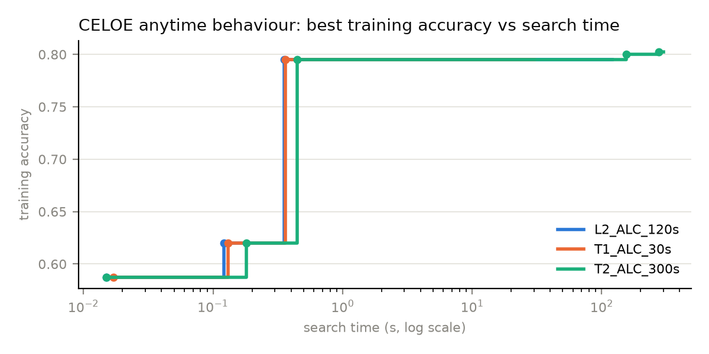
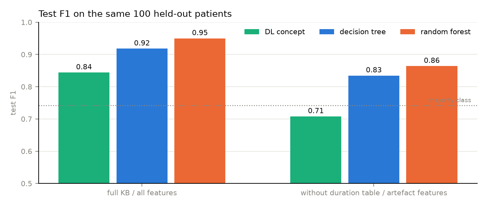
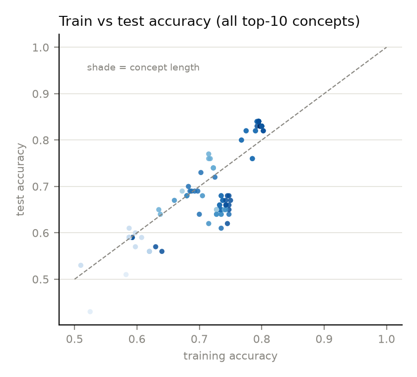

# Concept Induction in Description Logics on the CTU Hepatitis Relational Database

*Symbolic Learning, project report*

Authors: <member 1>, <member 2>
Code and ontology: `hepatitis_concept_induction.zip` (this archive), repository `hepatitis-concept-induction`.

## 1. Introduction

Concept induction learns a class expression $C$ from a knowledge base $\mathcal{O}=(\mathcal{T},\mathcal{A})$ and example sets $P$, $N$ such that $\mathcal{O}\models C(a)$ for $a\in P$ and $\mathcal{O}\not\models C(b)$ for $b\in N$. We apply it to real relational medical data: the **Hepatitis_std** database of the CTU Prague Relational Learning Repository. The database is converted into an OWL knowledge base, DL-Learner (CELOE and OCEL) learns class expressions describing patients of hepatitis type 1, the concepts are evaluated on held-out patients under closed- and open-world semantics, and the results are compared with decision trees and random forests trained on a propositionalised version of the same data and the same split.

Beyond the raw numbers, the project answers the analysis questions of the assignment: which concepts are meaningful, which are trivial or spurious, what changes between the open-world and the closed-world assumption, and what symbolic learning gives that the baseline does not, and vice versa.

## 2. Dataset

**Source.** Hepatitis_std (by Oliver Schulte) at `relational.fel.cvut.cz/dataset/Hepatitis`, a standardised version of the PKDD'02 Discovery Challenge hepatitis data. The CTU page states: 7 tables, 12,927 rows, 26 columns, target table `dispat`, target column `Type`, 500 instances, no missing values, "numerical attributes were discretized and typed as varchar". The original challenge data describe 206 hepatitis-B against 484 hepatitis-C patients; the standardised version keeps 500 patients and CTU notes that the reason is unknown. We exported the database with `mysqldump` from the public CTU server (`data/raw/Hepatitis_std.sql`) and converted it to CSV (`src/prepare_dataset.py`). All counts match the official page exactly (`src/validate_data.py`: 56 integrity checks, 0 failures).

**Schema.** Four entity tables and three link tables:

| Table | Rows | Content | Link to patients |
|---|---:|---|---|
| `dispat` | 500 | patient: `sex` (0/1), `age` category (0–6), **`Type`** (0/1) | target table |
| `Bio` | 32 | biopsy profile: `fibros` (0–4), `activity` (0–4) | `rel11`, 621 links, 1–5 per patient, **many-to-many** |
| `indis` | 5,691 | laboratory record: `got`, `gpt`, `alb`, `tbil`, `dbil`, `che`, `ttt`, `ztt`, `tcho`, `tp` (ordinal codes) | `rel12`, 5,691 links, 0–105 per patient |
| `inf` | 196 | antibody-duration category `dur` (0–4) | `rel13`, 196 links, 0–1 per patient |

**Target.** `Type` = 1 for 294 patients (58.8 %), 0 for 206. The 206 count coincides with the 206 hepatitis-B cases of the original data, so Type 0 = B and Type 1 = C is plausible, but neither CTU nor the ILP re-distribution of the data states the mapping; we treat it as an inference. The clinical meaning and direction of the discretised codes are not documented either, so the interpretation of learned concepts is structural (which relation, which code) rather than clinical.

**Relational structure that matters.** The `Bio` table is de-duplicated: only 20 distinct (fibrosis, activity) pairs exist among its 32 rows and one row is linked to 112 patients, so a `Bio` row is a shared *profile*, not a biopsy event. Lab records are genuinely one-to-many (median 7 records for Type-0 and 10 for Type-1 patients). Only 196 patients have a duration record.

**Class-conditional analysis** (`src/eda.py`, Figure 1) revealed structural signals that occur in one class only:

| Structural feature | Type 0 | Type 1 | share of Type 1 |
|---|---:|---:|---:|
| has a duration record | 0 | 196 | 0.67 |
| ≥ 2 Bio links | 0 | 82 | 0.28 |
| > 21 lab records | 0 | 47 | 0.16 |
| linked to a Bio row with activity = 4 | 0 | 41 | 0.14 |
| duration record **or** ≥ 2 Bio links | 0 | 218 | 0.74 |

These are real data, not labels, but they are almost certainly artefacts of how the study collected data per hepatitis type (antibody duration was only recorded for one group). They make the learning problem partly trivial and are treated explicitly in the experiments (Section 5.4). Among the ordinary attributes, `ztt` (code 5), `che` (codes 2, 4, 9), `tp`, `age` and `sex` differ most between the classes (Figure 2).

## 3. Knowledge base

The ontology is generated by `src/build_ontology.py` (Owlready2), following the assignment's recipe: rows become individuals, categorical values become classes, numeric values become data properties, foreign keys become object properties. Details are in `docs/modelling_choices.md`.

* **Individuals**: 500 `Patient`, 32 `BioProfile`, 5,691 `LabRecord`, 196 `DurationRecord` (6,419 in total).
* **Object properties**: `hasBioProfile`, `hasLabRecord`, `hasDurationRecord` (Patient → record), 6,508 assertions. Shared `Bio` rows are one individual with many incoming links. No inverse properties.
* **Value classes**: one per observed code, as subclasses of the entity class, e.g. `GOT_3 ⊑ LabRecord`, `Age_5 ⊑ Patient`, `Fibrosis_4 ⊑ BioProfile`, `Duration_2 ⊑ DurationRecord` (69 classes, ~70k class assertions).
* **Data properties**: the same codes as integers (`gotCode`, `ageCode`, …, 15 properties, ~62k assertions) so that ordinal thresholds such as `zttCode ≥ 4` can be learned when datatype restrictions are enabled.
* **Discretisation**: none needed, all attributes are already discretised by the provider. **Missing values**: none in the database; absent links (304 patients without a duration record, 4 without lab records) are simply absent.
* **Target separation**: `Type` is never written to the ontology; labels live in `labels.csv` and the learner only sees training IRIs as $P$/$N$.
* **Variants**: v1 `hepatitis.owl` (as above); v2 `hepatitis_v2.owl` adds 16 `AllDisjoint` axioms (entity classes; sibling value classes of the same attribute) and is the main KB; `hepatitis_v2_noinf.owl` removes the `inf` table and `hasDurationRecord` for the artefact ablation. A `--closure` variant with per-patient role closure (`hasX only {…}`) exists but was not used in the final runs.

The KB is consistent (HermiT, 2.6 s). DL-Learner loads and materialises it in about 3 s; it is 7.7 MB in RDF/XML.

## 4. Learning problem

* **Target**: patients with Type = 1. $P$ = 235 and $N$ = 165 training patients from a stratified 80/20 split (seed 42, `configs/folds/`); 59 + 41 test patients are never shown to the learner (`src/make_dl_configs.py` writes only training IRIs into the `.conf` files).
* **Leakage**: the target is not asserted in the KB (checked by `src/validate_data.py` and `tests/`); the structural artefacts above are not labels but are analysed as potential trivial solutions.
* **Hypothesis languages** (DL-Learner refinement operator `rho`, start class `Patient`): EL (⊓, ⊔, ∃), ALC (+ ¬, ∀), ALCQ (+ ≥n/≤n r.C, n ≤ 5), ALC(D) (+ `p some integer[≥ k]` on the code properties), FULL (all). `hasValue`, boolean and string datatypes are disabled.
* **Semantics for learning**: DL-Learner's closed-world reasoner (materialised ABox); negation is complement, ∀ is vacuously true without successors.

## 5. Experiments

All 21 configurations are committed in `configs/dl-learner/*.conf` and generated from `configs/experiments/grid.json`. Defaults: CELOE, KB v2, ALC, 120 s, max depth 7, noise 50 %, expansion penalty 0.1, predictive accuracy. Each run's full log is in `results/logs/`; every reported training accuracy was reproduced by an independent Python closed-world evaluator (`src/dl_concepts.py`, 215 of 215 concepts match DL-Learner's value, `tests/test_dl_concepts.py`), which also computes the test metrics.

### 5.1 Main results

| Run | Setting | Best concept | Len. | Train acc / F1 | **Test acc** | **Test P** | **Test R** | **Test F1** |
|---|---|---|---:|---|---:|---:|---:|---:|
| L1 | EL, 120 s | `(Age_5 ⊓ Sex_1) ⊔ ∃hasDurationRecord.⊤` | 7 | 0.803 / 0.813 | 0.82 | 0.918 | 0.763 | 0.833 |
| L2 | ALC, 120 s | `∃hasDurationRecord.DurationRecord` | 3 | 0.795 / 0.789 | 0.84 | 1.000 | 0.729 | 0.843 |
| L3 | ALCQ | same | 3 | 0.795 / 0.789 | 0.84 | 1.000 | 0.729 | 0.843 |
| L4 | ALC(D) | same | 3 | 0.795 / 0.789 | 0.84 | 1.000 | 0.729 | 0.843 |
| L5 | FULL | same | 3 | 0.795 / 0.789 | 0.84 | 1.000 | 0.729 | 0.843 |
| T2 | ALC, 300 s | `(Age_5 ⊓ Sex_1) ⊔ ∃hasDurationRecord.⊤` | 7 | 0.803 / 0.813 | 0.82 | 0.918 | 0.763 | 0.833 |
| X1 | ALCQ, noise 90 %, 300 s | `Age_6 ⊔ ∃hasDurationRecord.⊤` | 5 | 0.800 / 0.810 | 0.83 | 0.920 | 0.780 | 0.844 |
| N1 | ALC, noise 0 % | `Patient ⊓ (Sex_0 ⊔ ¬Age_0)` | 6 | 0.593 / 0.743 | 0.59 | 0.590 | 1.000 | 0.742 |
| N2 | ALC, noise 25 % | `∃hasLabRecord.(CHE_6 ⊓ ¬ZTT_1)` | 6 | 0.725 / 0.797 | 0.72 | 0.682 | 0.983 | 0.806 |
| O1 | OCEL, ALC | no solution; best found `∃hasDurationRecord.⊤` (0.795) | 3 | – | – | – | – | – |
| A2 | ALC, **KB without `inf`** | `∃hasLabRecord.(ZTT_5 ⊓ ¬GPT_3)` | 6 | 0.738 / 0.764 | 0.67 | 0.796 | 0.593 | 0.680 |
| A1 | FULL, KB without `inf` | `Age_6 ⊔ (≥2 hasLabRecord.ZTT_5)` | 6 | 0.748 / 0.773 | 0.63 | 0.795 | 0.525 | 0.633 |
| X2 | ALC(D), KB without `inf`, 300 s | `∃hasLabRecord.(ZTT_5 ⊔ (ALB_0 ⊓ TTT_0))` | 7 | 0.750 / 0.783 | 0.67 | 0.732 | 0.695 | 0.708 |

Full per-run table: `results/tables/summary_dl.csv`; all top-10 solutions with test metrics: `results/tables/concept_eval.csv`. Majority-class reference: accuracy 0.59, F1 0.742.

### 5.2 Effect of the settings varied

**Hypothesis language (L1–L5).** With the full KB every language converges on the duration artefact. The richer languages do not find anything better within 120 s, they simply have a larger branching factor: EL tests 193k descriptions in 120 s, ALC 85k, ALCQ 85k, ALC(D) 73k, FULL 59k. EL is therefore the only language that reached the better disjunction `(Age_5 ⊓ Sex_1) ⊔ ∃hasDurationRecord.⊤` (train 0.803) inside the budget. On the artefact-free KB the languages differ in substance: cardinality (A1) yields `≥2 hasLabRecord.ZTT_5` ("at least two lab records with the highest ZTT code"), negation (A2) yields `∃hasLabRecord.(ZTT_5 ⊓ ¬GPT_3)`, and datatype restrictions (X2) were available but the best solutions used the value classes.

**Runtime (T1 30 s, L2 120 s, T2 300 s).** CELOE is an anytime algorithm: the duration concept is found after 0.09–0.45 s in every run; the next improvement (`Age_6 ⊔ …`, +0.5 %) needs 20 s in EL and 2.5 min in ALC; the 300 s ALC run reaches 0.803 after 4 min 35 s (Figure 3). More time buys marginal training accuracy and **worse** test F1 (0.843 → 0.833): the added disjuncts fit training noise.

**Maximum depth (D1 4, L2 7, D2 12)** and **heuristic expansion penalty (H1 0.02, L2 0.1, H2 0.3)** did not change the best concept. A low penalty (0.02) makes the search much deeper and narrower (4.9k nodes vs 21k for 57k descriptions) and produces the longest, most redundant solutions, e.g. `∃hasDurationRecord.(¬Duration_0 ⊔ ¬Duration_3)`, which is logically identical to `∃hasDurationRecord.⊤` on this ABox (a typical "overly long" solution).

**Noise (N1 0 %, N2 25 %, L2 50 %, N3 75 %, X1 90 %).** This was the most consequential setting. CELOE prunes a candidate as *too weak* when it fails to cover more than `noisePercentage` of the positives. With 0 % only concepts covering all 235 positives survive, which here are near-tautologies (`Patient ⊓ (Sex_0 ⊔ ¬Age_0)`, 59 %). With 25 % the duration concept (covers 153/235 = 65 %) is pruned and the learner finds the high-recall lab concept `∃hasLabRecord.(CHE_6 ⊓ ¬ZTT_1)` (test recall 0.98, precision 0.68). From 50 % upwards the duration concept dominates. Only the 90 % run with 300 s combined it with `Age_6` into the best test F1 of the study (0.844). The noise parameter thus acts as a hard constraint on the shape of acceptable hypotheses, not merely as a tolerance.

**Accuracy method (N4, F-measure)** gave the same concept as predictive accuracy. **OCEL (O1)** tested 948k descriptions but reported no solution because none reached its noise criterion; its best expression was again `∃hasDurationRecord.⊤`.

### 5.3 Open-world versus closed-world

Each run's best concept was asserted as `LearnedConcept ≡ C` and classified with HermiT (`src/evaluate_concepts.py`, `results/tables/concept_owa.csv`), on v1 (no disjointness) and v2 (disjointness):

| Concept | CWA patients | OWA, v1 | OWA, v2 |
|---|---:|---:|---:|
| `∃hasDurationRecord.DurationRecord` | 196 | 196 | 196 |
| `(Age_5 ⊓ Sex_1) ⊔ ∃hasDurationRecord.⊤` | 237 | 237 | 237 |
| `Patient ⊓ (Sex_0 ⊔ ¬Age_0)` | 498 | 355 | 498 |
| `∃hasLabRecord.(ZTT_5 ⊓ ¬GPT_3)` | 254 | timeout (0 expected) | 254 |
| `Age_6 ⊔ (≥2 hasLabRecord.ZTT_5)` | 249 | 71 | 243 |
| `∀hasLabRecord.¬CHE_2` (from the 0 % noise runs) | 475 | timeout | timeout |

Existential concepts are entailed identically under both assumptions. Negation is **not** entailed without disjointness: a `Sex_1` patient is not provably `¬Sex_0`, so the OWA extension of `Sex_0 ⊔ ¬Age_0` shrinks from 498 to 355 patients, and `ZTT_5 ⊓ ¬GPT_3` has no provable instances. The 16 disjointness axioms of v2 restore the closed-world answers for negation and for qualified cardinalities (`≥2` needs provably distinct fillers, which disjoint value classes provide for 243 of 249 patients). Universal restrictions remain unentailed (and expensive for the reasoner) because no closure axioms state that the listed lab records are *all* of a patient's records; the `--closure` variant of the KB would add them at the price of a much heavier ontology. Practical consequence: the closed-world reasoner is the right tool for learning, but a concept with ¬ or ∀ is only meaningful under OWA if the ontology carries the corresponding disjointness/closure axioms, which is why we added them.

### 5.4 Trivial, spurious and overly long solutions

* **Trivial**: with noise 0 % the solutions are tautologies over `Patient` (`Sex_0 ⊔ ¬Age_0` covers 498 of 500 patients).
* **Spurious but accurate**: `∃hasDurationRecord.⊤` is perfectly precise (test precision 1.0) and would be a strong clinical claim ("every patient with a recorded antibody duration has type 1"). It is almost certainly a data-collection artefact of the PKDD'02 study rather than medicine, as are `≥2 hasBioProfile` and `>21 lab records`. The learner cannot tell the difference; only the domain analysis in Section 2 can. The ablation KB without `inf` shows what remains once the artefact is removed: the best concepts drop to 0.74–0.75 training and 0.67–0.68 test accuracy and are built from laboratory patterns (`ZTT_5`, `CHE_6`, `GPT_3`, `TTT_0`) that are consistent with the class-conditional statistics (ZTT code 5 is 91 % Type 1 at record level).
* **Overly long**: `∃hasDurationRecord.(¬Duration_0 ⊔ ¬Duration_3)`, `(Age_6 ⊔ ∃hasDurationRecord.⊤) ⊓ ¬Age_0` and similar top-10 entries add constructors without changing the extension or at a cost in test F1; the length penalty of CELOE keeps them below the short version but they fill the solution list.

### 5.5 Baseline: decision tree and random forest on the same split

`src/propositionalise.py` flattens the database into 107 patient-level features (counts per relation; min/max/mean/mode per lab attribute; "exists a record with code k" indicators, the propositional counterpart of `∃hasLabRecord.LAB_k`; Bio aggregates; duration value). `src/baseline_ml.py` trains majority, decision tree and random forest with 5-fold CV on the 400 training patients for hyperparameters and evaluates on the same 100 test patients:

| Features | Model | Size | Test acc | Test P | Test R | **Test F1** |
|---|---|---|---:|---:|---:|---:|
| flat (sex, age) | decision tree | depth 4, 10 leaves | 0.57 | 0.618 | 0.712 | 0.661 |
| flat | random forest | 300 trees | 0.57 | 0.618 | 0.712 | 0.661 |
| relational (107) | decision tree | depth 4, 8 leaves | 0.90 | 0.889 | 0.949 | 0.918 |
| relational | random forest | 300 trees | 0.94 | 0.934 | 0.966 | 0.950 |
| relational w/o artefacts (104) | decision tree | depth 3, 6 leaves | 0.79 | 0.779 | 0.898 | 0.835 |
| relational w/o artefacts | random forest | 300 trees | 0.83 | 0.818 | 0.915 | 0.864 |
| – | majority class | – | 0.59 | 0.590 | 1.000 | 0.742 |

The flat patient table is at chance: all signal is relational. The relational tree's root is `dur_value` (the same artefact DL-Learner found, as a leaf with 153 training Type-1 patients and no Type-0), followed by `ztt_mean`, `n_bio`, `tcho_mode`, `che_mean` and `age`. Without the artefact features the tree uses `che_mode`, `ztt_any_1`, `ztt_mean`, `che_any_5` and `age` (rules in `results/tables/tree_rules_*.txt`).

## 6. Discussion

**Performance.** On the full KB the best DL concept (test F1 0.843–0.844, precision 1.0) is close to the decision tree (0.918) and below the random forest (0.950). Without the artefact the gap widens: 0.71 vs 0.835 (tree) and 0.864 (forest). The CTU repository lists published accuracies of 0.63–0.81 for relational learners on this database, so our numbers are in the expected range; the baselines exceed them because the aggregate features (means, modes, counts over up to 105 records) summarise a patient's whole lab history, which a DL concept of length ≤ 7 built from existential restrictions cannot express. `∃hasLabRecord.ZTT_5` says "some record has code 5"; the tree can say "the average ZTT over all records exceeds 3.4". Aggregation over roles is exactly the expressiveness the hypothesis language lacks (cardinality `≥2 hasLabRecord.ZTT_5` is the closest approximation and was indeed selected in A1).

**Interpretability.** Every DL solution is a single readable sentence over the schema, e.g. "a patient with an antibody-duration record, or a female patient in the oldest age band", and its test precision/recall are those of that sentence alone. The depth-4 tree with 8 leaves is also readable but encodes thresholds on engineered aggregates whose meaning is one step removed from the data; the forest is a black box. A domain expert would reject the duration concept as an artefact and would recognise `ZTT_5`/`CHE_6` patterns as plausible liver-function signals, but without the code book no clinical interpretation can be defended.

**Generalisation.** Train and test accuracies agree closely for short concepts (Figure 5, `results/figures/generalisation.png`); the longer disjunctions found with more search time gain 0.5–1 % on training and lose 1 % on test. On 400 examples, concept length is an effective regulariser.

**What symbolic learning gave that the baseline did not.** (i) Hypotheses stated directly in the vocabulary of the relational schema, including roles, with no feature engineering; (ii) explicit control of the hypothesis space (we could forbid negation or cardinality and see what changes); (iii) a diagnosis of the data: the artefact was *obvious* in the learned concept, whereas in the forest it is one importance score among 107. **What the baseline gave that symbolic learning did not.** (i) Aggregation over one-to-many relations; (ii) higher accuracy; (iii) robustness to the noise/pruning settings, which for CELOE decide what can be found at all.

**Limitations.** The semantics of the codes and of `Type` are undocumented; a single 80/20 split (cross-validation would multiply the 2–5 min DL-Learner runs); the KB (6.4k individuals) is at the upper end of what CELOE explores effectively in minutes, with retrieval dominating the runtime; universal restrictions could not be evaluated under OWA without closure axioms.

## 7. Conclusion

We converted a seven-table relational database into a 6,419-individual OWL knowledge base, learned class expressions for hepatitis type 1 with DL-Learner under five hypothesis languages and four further settings, evaluated 215 concepts on held-out patients under closed- and open-world semantics, and compared them with trees and forests on the same split. Concept induction found a perfectly precise but spurious role-based concept, identified it transparently, and, once the artefact was removed, produced plausible laboratory concepts at 0.67–0.68 test accuracy against 0.79–0.83 for the baselines. The decisive practical lessons were the role of the noise parameter in CELOE's pruning, and the need for disjointness (and, for ∀, closure) axioms before negative or universal concepts mean anything under the open-world assumption.

## 8. Contributions

*<Member 1>*: <paragraph describing what this member did, e.g. database export and validation, ontology construction, split, documentation>.

*<Member 2>*: <paragraph describing what this member did, e.g. DL-Learner configuration and experiments, evaluation code, baselines, report>.

## References

* Project description, *Symbolic Learning* course.
* J. Lehmann, "DL-Learner: Learning Concepts in Description Logics", JMLR 10, 2009; J. Lehmann et al., "Class expression learning for ontology engineering" (CELOE), J. Web Semantics 9, 2011. https://dl-learner.org
* J. Motl, O. Schulte, "The CTU Prague Relational Learning Repository", arXiv:1511.03086, 2015. https://relational.fel.cvut.cz/dataset/Hepatitis
* J.-B. Lamy, "Owlready: Ontology-oriented programming in Python", Artificial Intelligence in Medicine 80, 2017.
* B. Glimm et al., "HermiT: An OWL 2 Reasoner", J. Automated Reasoning 53, 2014.
