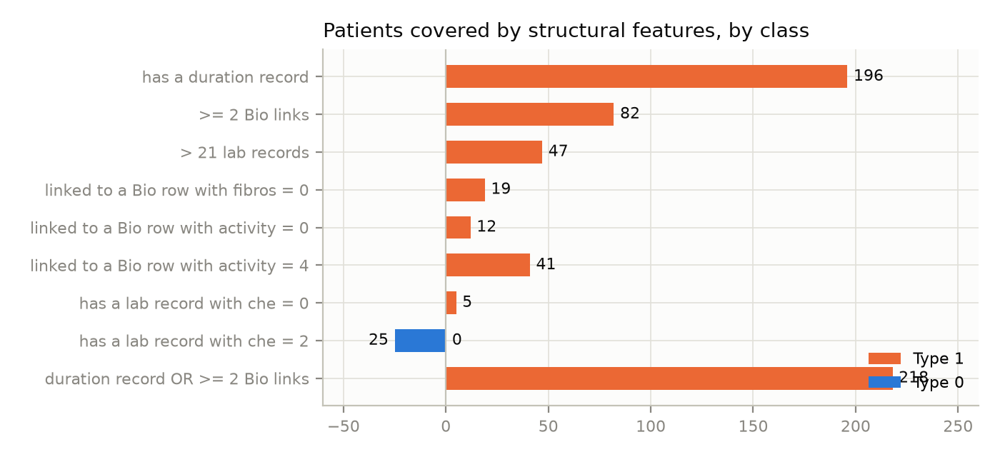
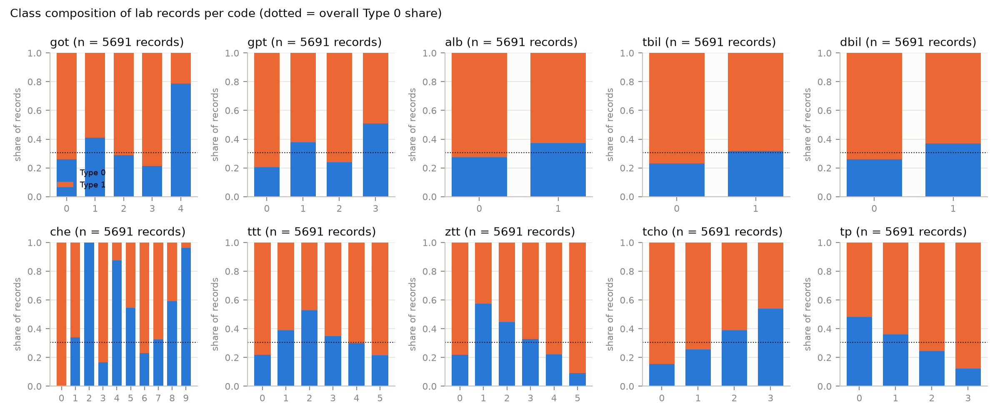

# Concept Induction in Description Logics on the CTU Hepatitis Relational Database

**Symbolic Learning, project report, Group 8**
Kamal Mustafayev, Elvin Mahmudzada, Huseyn Babayev

Repository: `hepatitis-concept-induction`. Final solution: branch `dev`. Experimental alternative: branch `enmda`.

## 1. Introduction

Concept induction learns a class expression $C$ from a knowledge base $\mathcal{O}=(\mathcal{T},\mathcal{A})$ and example sets $P$, $N$ such that $\mathcal{O}\models C(a)$ for $a\in P$ and $\mathcal{O}\not\models C(b)$ for $b\in N$. We apply it to real relational medical data, the **Hepatitis_std** database of the CTU Prague Relational Learning Repository. The database is converted into an OWL knowledge base, DL-Learner learns class expressions describing one hepatitis type, the learned concepts are evaluated on held-out patients under closed- and open-world semantics, and the results are compared with decision trees and random forests trained on a propositionalised version of the same data and the same split.

The group developed two implementations. The final solution (branch `dev`, Sections 3 to 7) is a complete, documented pipeline with a single fixed train/test split, three knowledge-base variants and 21 DL-Learner configurations. In parallel, an experimental alternative (branch `enmda`, Section 8) explored a different protocol: five-fold cross-validation, an artefact-free knowledge base as the primary learning problem, and the opposite target class. The alternative confirmed the main findings and contributed two design ideas that we recommend for future work.

## 2. Dataset

**Source.** Hepatitis_std (by Oliver Schulte) at `relational.fel.cvut.cz/dataset/Hepatitis`, a standardised version of the PKDD'02 Discovery Challenge hepatitis data. The CTU page states: 7 tables, 12,927 rows, 26 columns, target table `dispat`, target column `Type`, 500 instances, no missing values, "numerical attributes were discretized and typed as varchar". The original challenge data describe 206 hepatitis-B against 484 hepatitis-C patients; the standardised version keeps 500 patients. The database was exported with `mysqldump` from the public CTU server (`data/raw/Hepatitis_std.sql`) and converted to CSV (`src/prepare_dataset.py`). All counts match the official page exactly (`src/validate_data.py`: 56 integrity checks, 0 failures).

**Schema.** Four entity tables and three link tables:

| Table | Rows | Content | Link to patients |
|---|---:|---|---|
| `dispat` | 500 | patient: `sex` (0/1), `age` category (0–6), **`Type`** (0/1) | target table |
| `Bio` | 32 | biopsy profile: `fibros` (0–4), `activity` (0–4) | `rel11`, 621 links, 1–5 per patient, many-to-many |
| `indis` | 5,691 | laboratory record: `got`, `gpt`, `alb`, `tbil`, `dbil`, `che`, `ttt`, `ztt`, `tcho`, `tp` (ordinal codes) | `rel12`, 5,691 links, 0–105 per patient |
| `inf` | 196 | antibody-duration category `dur` (0–4) | `rel13`, 196 links, 0–1 per patient |

**Target.** `Type` = 1 for 294 patients (58.8 %), 0 for 206. The 206 count coincides with the 206 hepatitis-B cases of the original data, so Type 0 = B and Type 1 = C is plausible, but neither CTU nor the ILP re-distribution of the data states the mapping. The clinical meaning and direction of the discretised codes are not documented either, so the interpretation of learned concepts is structural (which relation, which code) rather than clinical.

**Relational structure.** The `Bio` table is de-duplicated: only 20 distinct (fibrosis, activity) pairs exist among its 32 rows and one row is linked to 112 patients, so a `Bio` row is a shared profile, not a biopsy event. Lab records are one-to-many (median 7 records for Type-0 and 10 for Type-1 patients). Only 196 patients have a duration record.

**Class-conditional analysis** (`src/eda.py`, Figure 1) revealed structural signals that occur in one class only:

| Structural feature | Type 0 | Type 1 | share of Type 1 |
|---|---:|---:|---:|
| has a duration record | 0 | 196 | 0.67 |
| ≥ 2 Bio links | 0 | 82 | 0.28 |
| > 21 lab records | 0 | 47 | 0.16 |
| linked to a Bio row with activity = 4 | 0 | 41 | 0.14 |
| duration record **or** ≥ 2 Bio links | 0 | 218 | 0.74 |

These are real data, not labels, but they are almost certainly artefacts of how the original study collected data per hepatitis type. They make the learning problem partly trivial and are treated explicitly in the experiments (Section 5.4). Among the ordinary attributes, `ztt` (code 5), `che` (codes 2, 4, 9), `tp`, `age` and `sex` differ most between the classes (Figure 2).

## 3. Knowledge base

The ontology is generated by `src/build_ontology.py` (Owlready2), following the assignment's recipe: rows become individuals, categorical values become classes, numeric values become data properties, foreign keys become object properties. Details are in `docs/modelling_choices.md`.

* **Individuals**: 500 `Patient`, 32 `BioProfile`, 5,691 `LabRecord`, 196 `DurationRecord` (6,419 in total).
* **Object properties**: `hasBioProfile`, `hasLabRecord`, `hasDurationRecord` (Patient → record), 6,508 assertions. Shared `Bio` rows are one individual with many incoming links.
* **Value classes**: one per observed code, as subclasses of the entity class, e.g. `GOT_3 ⊑ LabRecord`, `Age_5 ⊑ Patient` (69 classes, about 70k class assertions).
* **Data properties**: the same codes as integers (`gotCode`, `ageCode`, …, 15 properties, about 62k assertions) so that ordinal thresholds such as `zttCode ≥ 4` can be learned when datatype restrictions are enabled.
* **Discretisation**: none needed, all attributes are already discretised by the provider. **Missing values**: none in the database; absent links (304 patients without a duration record, 4 without lab records) are simply absent.
* **Target separation**: `Type` is never written to the ontology; labels live in `labels.csv` and the learner only sees training IRIs as $P$/$N$.
* **Variants**: v1 `hepatitis.owl`; v2 `hepatitis_v2.owl` adds 16 `AllDisjoint` axioms (entity classes; sibling value classes of the same attribute) and is the main KB; `hepatitis_v2_noinf.owl` removes the `inf` table and `hasDurationRecord` for the artefact ablation. A `--closure` option with per-patient role closure exists but was not used in the final runs.

The KB is consistent (HermiT). DL-Learner loads and materialises it in about 3 s; the file is 7.7 MB in RDF/XML.

## 4. Learning problem

* **Target**: patients with Type = 1. $P$ = 235 and $N$ = 165 training patients from a stratified 80/20 split (seed 42, `configs/folds/`); 59 + 41 test patients are never shown to the learner (`src/make_dl_configs.py` writes only training IRIs into the `.conf` files).
* **Leakage**: the target is not asserted in the KB (checked by `src/validate_data.py` and `tests/`); the structural artefacts above are not labels but are analysed as potential trivial solutions.
* **Hypothesis languages** (DL-Learner refinement operator `rho`, start class `Patient`): EL (⊓, ⊔, ∃), ALC (+ ¬, ∀), ALCQ (+ ≥n/≤n r.C, n ≤ 5), ALC(D) (+ `p some integer[≥ k]` on the code properties), FULL (all). `hasValue`, boolean and string datatypes are disabled.
* **Semantics for learning**: DL-Learner's closed-world reasoner (materialised ABox); negation is complement, ∀ is vacuously true without successors.

## 5. Experiments (final solution, branch `dev`)

All 21 configurations are committed in `configs/dl-learner/*.conf` and generated from `configs/experiments/grid.json`. Defaults: CELOE, KB v2, ALC, 120 s, max depth 7, noise 50 %, expansion penalty 0.1, predictive accuracy. Each run's full log is in `results/logs/`; every reported training accuracy was reproduced by an independent Python closed-world evaluator (`src/dl_concepts.py`; 215 of 215 concepts match DL-Learner's value, `tests/test_dl_concepts.py`), which also computes the test metrics.

### 5.1 Main results

| Run | Setting | Best concept | Len. | Train acc / F1 | Test acc | Test P | Test R | Test F1 |
|---|---|---|---:|---|---:|---:|---:|---:|
| L1 | EL, 120 s | `(Age_5 ⊓ Sex_1) ⊔ ∃hasDurationRecord.⊤` | 7 | 0.803 / 0.813 | 0.82 | 0.918 | 0.763 | 0.833 |
| L2 | ALC, 120 s | `∃hasDurationRecord.DurationRecord` | 3 | 0.795 / 0.789 | 0.84 | 1.000 | 0.729 | 0.843 |
| L3–L5 | ALCQ, ALC(D), FULL | same | 3 | 0.795 / 0.789 | 0.84 | 1.000 | 0.729 | 0.843 |
| T2 | ALC, 300 s | `(Age_5 ⊓ Sex_1) ⊔ ∃hasDurationRecord.⊤` | 7 | 0.803 / 0.813 | 0.82 | 0.918 | 0.763 | 0.833 |
| X1 | ALCQ, noise 90 %, 300 s | `Age_6 ⊔ ∃hasDurationRecord.⊤` | 5 | 0.800 / 0.810 | 0.83 | 0.920 | 0.780 | 0.844 |
| N1 | ALC, noise 0 % | `Patient ⊓ (Sex_0 ⊔ ¬Age_0)` | 6 | 0.593 / 0.743 | 0.59 | 0.590 | 1.000 | 0.742 |
| N2 | ALC, noise 25 % | `∃hasLabRecord.(CHE_6 ⊓ ¬ZTT_1)` | 6 | 0.725 / 0.797 | 0.72 | 0.682 | 0.983 | 0.806 |
| O1 | OCEL, ALC | no solution; best found `∃hasDurationRecord.⊤` (0.795) | 3 | – | – | – | – | – |
| A2 | ALC, KB without `inf` | `∃hasLabRecord.(ZTT_5 ⊓ ¬GPT_3)` | 6 | 0.738 / 0.764 | 0.67 | 0.796 | 0.593 | 0.680 |
| A1 | FULL, KB without `inf` | `Age_6 ⊔ (≥2 hasLabRecord.ZTT_5)` | 6 | 0.748 / 0.773 | 0.63 | 0.795 | 0.525 | 0.633 |
| X2 | ALC(D), KB without `inf`, 300 s | `∃hasLabRecord.(ZTT_5 ⊔ (ALB_0 ⊓ TTT_0))` | 7 | 0.750 / 0.783 | 0.67 | 0.732 | 0.695 | 0.708 |

Full per-run table: `results/tables/summary_dl.csv`; all top-10 solutions with test metrics: `results/tables/concept_eval.csv`. Majority-class reference: accuracy 0.59, F1 0.742.

### 5.2 Effect of the settings varied

**Hypothesis language (L1–L5).** With the full KB every language converges on the duration artefact. The richer languages do not find anything better within 120 s; they have a larger branching factor: EL tests 193k descriptions in 120 s, ALC 85k, ALCQ 85k, ALC(D) 73k, FULL 59k. EL is therefore the only language that reached the better disjunction inside the budget. On the artefact-free KB the languages differ in substance: cardinality (A1) yields `≥2 hasLabRecord.ZTT_5`, negation (A2) yields `∃hasLabRecord.(ZTT_5 ⊓ ¬GPT_3)`.

**Runtime (T1 30 s, L2 120 s, T2 300 s).** CELOE is an anytime algorithm: the duration concept is found after 0.09–0.45 s in every run; the next improvement needs 20 s in EL and 2.5 min in ALC; the 300 s run reaches 0.803 after 4 min 35 s (Figure 3). More time buys marginal training accuracy and slightly worse test F1 (0.843 → 0.833): the added disjuncts fit training noise.

**Maximum depth (D1 4, D2 12)** and **heuristic expansion penalty (H1 0.02, H2 0.3)** did not change the best concept. A low penalty makes the search deeper and narrower (4.9k nodes vs 21k) and produces redundant solutions such as `∃hasDurationRecord.(¬Duration_0 ⊔ ¬Duration_3)`, logically identical to `∃hasDurationRecord.⊤` on this ABox.

**Noise (N1 0 %, N2 25 %, L2 50 %, N3 75 %, X1 90 %).** This was the most consequential setting. CELOE prunes a candidate as too weak when it fails to cover more than `noisePercentage` of the positives. With 0 % only concepts covering all 235 positives survive, which here are near-tautologies. With 25 % the duration concept (covers 65 % of $P$) is pruned and the learner finds the high-recall lab concept `∃hasLabRecord.(CHE_6 ⊓ ¬ZTT_1)`. From 50 % upwards the duration concept dominates. The noise parameter is therefore a hard constraint on the shape of acceptable hypotheses, not merely a tolerance.

**Accuracy method (N4, F-measure)** gave the same concept. **OCEL (O1)** tested 948k descriptions but reported no solution because none reached its noise criterion.

### 5.3 Open-world versus closed-world

Each run's best concept was asserted as `LearnedConcept ≡ C` and classified with HermiT on the full ABox (`src/evaluate_concepts.py`, `results/tables/concept_owa.csv`), on v1 (no disjointness) and v2 (disjointness):

| Concept | CWA patients | OWA, v1 | OWA, v2 |
|---|---:|---:|---:|
| `∃hasDurationRecord.DurationRecord` | 196 | 196 | 196 |
| `(Age_5 ⊓ Sex_1) ⊔ ∃hasDurationRecord.⊤` | 237 | 237 | 237 |
| `Patient ⊓ (Sex_0 ⊔ ¬Age_0)` | 498 | 355 | 498 |
| `∃hasLabRecord.(ZTT_5 ⊓ ¬GPT_3)` | 254 | timeout (0 expected) | 254 |
| `Age_6 ⊔ (≥2 hasLabRecord.ZTT_5)` | 249 | 71 | 243 |
| `∀hasLabRecord.¬CHE_2` | 475 | timeout | timeout |

Existential concepts are entailed identically under both assumptions. Negation is not entailed without disjointness: a `Sex_1` patient is not provably `¬Sex_0`, so the OWA extension of `Sex_0 ⊔ ¬Age_0` shrinks from 498 to 355 patients. The 16 disjointness axioms of v2 restore the closed-world answers for negation and for qualified cardinalities. Universal restrictions remain unentailed because no closure axioms state that the listed lab records are all of a patient's records. Practical consequence: the closed-world reasoner is the right tool for learning, but a concept with ¬ or ∀ is only meaningful under OWA if the ontology carries the corresponding disjointness or closure axioms.

### 5.4 Trivial, spurious and overly long solutions

* **Trivial**: with noise 0 % the solutions are tautologies over `Patient`.
* **Spurious but accurate**: `∃hasDurationRecord.⊤` is perfectly precise (test precision 1.0) but is almost certainly a data-collection artefact rather than medicine, as are `≥2 hasBioProfile` and `>21 lab records`. The learner cannot tell the difference; only the data analysis in Section 2 can. The ablation KB shows what remains once the artefact is removed: 0.74–0.75 training and 0.67–0.68 test accuracy from laboratory patterns (`ZTT_5`, `CHE_6`, `GPT_3`, `TTT_0`) that agree with the class-conditional statistics.
* **Overly long**: `∃hasDurationRecord.(¬Duration_0 ⊔ ¬Duration_3)` and similar entries add constructors without changing the extension or at a cost in test F1.

### 5.5 Baseline: decision tree and random forest on the same split

`src/propositionalise.py` flattens the database into 107 patient-level features (counts per relation; min/max/mean/mode per lab attribute; "exists a record with code k" indicators, the propositional counterpart of `∃hasLabRecord.LAB_k`; Bio aggregates; duration value). `src/baseline_ml.py` trains majority, decision tree and random forest with 5-fold CV on the 400 training patients for hyperparameters and evaluates on the same 100 test patients:

| Features | Model | Size | Test acc | Test P | Test R | Test F1 |
|---|---|---|---:|---:|---:|---:|
| flat (sex, age) | decision tree | depth 4, 10 leaves | 0.57 | 0.618 | 0.712 | 0.661 |
| relational (107) | decision tree | depth 4, 8 leaves | 0.90 | 0.889 | 0.949 | 0.918 |
| relational | random forest | 300 trees | 0.94 | 0.934 | 0.966 | 0.950 |
| relational w/o artefacts (104) | decision tree | depth 3, 6 leaves | 0.79 | 0.779 | 0.898 | 0.835 |
| relational w/o artefacts | random forest | 300 trees | 0.83 | 0.818 | 0.915 | 0.864 |
| – | majority class | – | 0.59 | 0.590 | 1.000 | 0.742 |

The flat patient table is at chance: all signal is relational. The relational tree's root is `dur_value` (the same artefact DL-Learner found), followed by `ztt_mean`, `n_bio`, `tcho_mode`, `che_mean` and `age`. Without the artefact features the tree uses `che_mode`, `ztt_any_1`, `ztt_mean`, `che_any_5` and `age`.

## 6. Discussion

**Performance.** On the full KB the best DL concept (test F1 0.843–0.844, precision 1.0) is close to the decision tree (0.918) and below the random forest (0.950). Without the artefact the gap widens: 0.71 vs 0.835 (tree) and 0.864 (forest). The CTU repository lists published accuracies of 0.63–0.81 for relational learners on this database, so our numbers are in the expected range. The baselines exceed them because aggregate features (means, modes, counts over up to 105 records) summarise a patient's whole lab history, which a DL concept of length ≤ 7 built from existential restrictions cannot express. Qualified cardinality (`≥2 hasLabRecord.ZTT_5`) is the closest approximation and was indeed selected.

**Interpretability.** Every DL solution is a single readable sentence over the schema, and its test precision and recall are those of that sentence alone. The depth-4 tree with 8 leaves is also readable but encodes thresholds on engineered aggregates; the forest is a black box. A domain expert would reject the duration concept as an artefact and would recognise `ZTT_5`/`CHE_6` patterns as plausible liver-function signals, but without the code book no clinical interpretation can be defended.

**Generalisation.** Train and test accuracies agree closely for short concepts (Figure 5); longer disjunctions gain 0.5–1 % on training and lose 1 % on test. On 400 examples, concept length is an effective regulariser.

**What symbolic learning gave that the baseline did not.** Hypotheses stated directly in the vocabulary of the relational schema, including roles, with no feature engineering; explicit control of the hypothesis space; and a transparent diagnosis of the data artefact, which in the forest is one importance score among 107. **What the baseline gave that symbolic learning did not.** Aggregation over one-to-many relations, higher accuracy, and robustness to the noise and pruning settings that decide what CELOE can find at all.

## 7. Reproducibility

`run_all.sh` / `run_all.ps1` / `make all` run the complete pipeline from the SQL dump to the comparison tables: `prepare_dataset`, `validate_data`, `build_ontology` (three variants), `create_split`, `eda`, `make_dl_configs`, `run_dl_learner`, `evaluate_concepts`, `propositionalise`, `baseline_ml`, `compare`, and the tests. DL-Learner 1.5.0 runs on Java 21/25 with the `--add-opens` flags that the runner adds automatically. All logs, tables and figures are committed; `scripts/make_submission.py` builds the archive.

## 8. Experimental alternative: branch `enmda`

In parallel with the final solution, Elvin Mahmudzada developed an alternative implementation from scratch on branch `enmda`, to test whether a different protocol would change the conclusions. It shares the dataset and the DL-Learner/CELOE toolchain but differs in five design decisions.

**Implementation.** Nine numbered scripts: `01_download_data.py` pulls the tables directly from CTU's MariaDB server with `pymysql` and records the foreign keys from `information_schema`; `02_build_ontology.py` builds the ontology in two alternative encodings, ordinal codes as functional integer data properties (`hepatitis_datatype.owl`) or as one atomic class per bin (`hepatitis_classes.owl`), and **excludes the duration table by default**; a third ontology with the duration table serves only as a leakage demonstration. `03_make_folds.py` creates a stratified **5-fold cross-validation** split (seed 42). `04_make_conf.py` and `05_run_experiment.py` generate and run 12 settings × 5 folds = 60 configurations, in parallel across folds, except for the runtime experiments, which run sequentially so that the time budget is not shared. `kb_eval.py` is an independent closed-world evaluator that also reproduces an off-by-one behaviour of DL-Learner's `max` cardinality retrieval. `06_baseline.py` trains trees and a forest on 38 aggregate features; `07_owa_check.py` runs HermiT on a 20-patient stratified sample; `08_summary.py` collects everything.

**Learning problem.** $P$ = Hepatitis B (Type 0, 206 patients), $N$ = Hepatitis C, i.e. the opposite polarity of the final solution. Defaults: CELOE, closed-world reasoner, 60 s, noise 30 %, full language including numeric ranges.

**Results** (mean ± std over the 5 folds, `results/summary.csv`):

| Setting | Best concept (typical fold) | Test acc | Test F1 |
|---|---|---:|---:|
| base (60 s, noise 30, numeric) | `∃hasExam.(che ∈ [2, 5])` | 0.774 ± 0.030 | 0.731 ± 0.034 |
| restricted language (no ¬, ∀, ≥n) | same concept | 0.774 ± 0.030 | 0.731 ± 0.034 |
| runtime 10 / 60 / 180 s | same concept | 0.774 | 0.731 |
| bins as atomic classes | `AGE_1 ⊔ ∃hasExam.(CHE_5 ⊓ ¬TP_3)` | 0.736 ± 0.040 | 0.678 ± 0.057 |
| noise 10 % | `∃hasExam.(ttt ≥ 2 ⊓ ztt ≤ 3)` | 0.592 ± 0.043 | 0.650 ± 0.025 |
| penalty 0.02 / 0.01 | long conjunctions, length 11–13 | 0.710 / 0.634 | 0.675 / 0.610 |
| OWA: CELOE with HermiT as reasoner | `Sex0`, 8 concepts tested in about 1000 s | 0.506 | 0.560 |
| with duration table (leakage demo) | `∀hasTherapy.⊥ ⊓ ≤1 hasBiopsy.⊤` | 0.848 ± 0.019 | 0.845 ± 0.015 |
| tree depth 2 / depth 4 / forest | 38 aggregate features | 0.784 / 0.802 / 0.866 | 0.754 / 0.769 / 0.831 |

The same concept, `∃hasExam.(che ∈ [2,5])`, is found in every fold, with every runtime budget and with the restricted language, so it is stable. With the duration table included, the learner immediately finds `∀hasTherapy.⊥` (no therapy record), the mirror image of our `∃hasDurationRecord.⊤`, with recall 1.0 for Hepatitis B. Noise 10 % collapses to near-majority concepts, confirming the pruning effect reported in Section 5.2. Learning directly under OWA with HermiT as DL-Learner's reasoner is infeasible: 8 concepts in 17 minutes.

**Comparison with the final solution.**

| Aspect | Final solution (`dev`) | Alternative (`enmda`) |
|---|---|---|
| Evaluation protocol | one stratified 80/20 split, 100 test patients | 5-fold CV, mean ± std |
| Primary knowledge base | full KB; artefact analysed and ablated | artefact-free KB; full KB only as leakage demo |
| Encodings | value classes and integer properties together | two separate ontologies |
| Hypothesis languages | EL, ALC, ALCQ, ALC(D), FULL | full vs restricted |
| OWA analysis | HermiT on the full ABox, v1 vs v2 disjointness, 42 evaluations | HermiT on a 20-patient sample; CELOE-with-HermiT run |
| Best artefact-free DL result | 0.67–0.68 accuracy, F1 0.71 (holdout) | 0.774 accuracy, F1 0.731 (CV) |
| Best baseline (artefact-free) | forest 0.83 acc, F1 0.864 | forest 0.866 acc, F1 0.831 |
| Documentation and deliverables | README, 4 docs, EDA, figures, report, slides | code and results only |
| Portability | relative paths, Windows and Linux | absolute paths of one machine |

**Strengths of the alternative.** Cross-validated numbers are more trustworthy than a single split; excluding the artefact up front makes the primary results describe laboratory structure; the interval restriction `che ∈ [2,5]` generalised better than any artefact-free concept of the final solution; and the runtime experiments were isolated from CPU sharing. **Limitations.** No report, documentation or exploratory analysis; the open-world comparison is on a small sample; the "leakage" label is debatable because the duration record is data, not the label; configurations are tied to one machine. For these reasons `dev` is the submitted solution, and we recommend adopting the 5-fold protocol and the artefact-free primary problem from `enmda` in any continuation.

## 9. Conclusion

We converted a seven-table relational database into a 6,419-individual OWL knowledge base, learned class expressions with DL-Learner under five hypothesis languages and four further settings, evaluated 215 concepts on held-out patients under closed- and open-world semantics, and compared them with trees and forests on the same split. Concept induction found a perfectly precise but spurious role-based concept, identified it transparently, and, once the artefact was removed, produced plausible laboratory concepts at 0.67–0.68 test accuracy (0.774 under cross-validation in the alternative implementation) against 0.79–0.87 for the baselines. The decisive practical lessons were the role of the noise parameter in CELOE's pruning, the need for disjointness (and, for ∀, closure) axioms before negative or universal concepts mean anything under the open-world assumption, and the value of cross-validation on 500 examples. Both implementations reached the same conclusions by different routes.

## 10. Contributions

*Kamal Mustafayev: concept learning and evaluation (final solution).* Kamal implemented the symbolic-learning core of branch `dev`. He defined the learning problem and the five hypothesis languages, wrote the experiment grid and the configuration generator that produced the 21 committed `.conf` files (`grid.json`, `make_dl_configs.py`), the DL-Learner runner with log parsing of solutions, anytime curves and search statistics and the Java 21/25 compatibility fix (`run_dl_learner.py`), and ran all experiments. He wrote the Manchester-syntax parser and the independent closed-world evaluator that reproduces DL-Learner's training accuracies and scores all 215 concepts on the test patients, with its test suite (`dl_concepts.py`, `evaluate_concepts.py`, `tests/`), extended the ontology generator with the disjointness and artefact-free variants, and produced the analysis of the noise parameter, the hypothesis-language ladder, runtime, heuristic and the spurious and overly long solutions (Sections 4, 5.1, 5.2 and 5.4).

*Elvin Mahmudzada: alternative implementation and open-world analysis.* Elvin developed the experimental alternative on branch `enmda` from scratch: direct database access through `pymysql`, the two ontology encodings, the 5-fold cross-validation protocol shared by DL-Learner and the baselines, the parallel experiment runner with 60 configurations over 12 settings, an independent closed-world evaluator including the study of DL-Learner's cardinality retrieval, the leakage demonstration with the duration table and the sampled HermiT check (Section 8). Building on that experience, he was responsible for the open-world side of the final solution: the HermiT evaluation of every run's best concept on the full ABox, the comparison of v1 and v2 that isolates the effect of the disjointness axioms, the timeout handling for universal restrictions, and the OWA/CWA discussion and the role-closure option documented in Section 5.3 and `docs/modelling_choices.md`.

*Huseyn Babayev: data, knowledge base, baselines and deliverables.* Huseyn built the foundation of the project: the repository structure and environment, the export of Hepatitis_std from the CTU server and its parsing into validated CSV tables (`prepare_dataset.py`, `validate_data.py`), the dataset analysis and codebook (`docs/dataset_analysis.md`), the first OWL ontology with Owlready2 and its validation with HermiT (`build_ontology.py`), the reproducible stratified split (`create_split.py`) and the environment documentation. On top of this he owned the comparison with classical machine learning and the final integration: the exploratory analysis and figures of Section 2 (`eda.py`), the propositionalisation into 107 patient-level features and the decision-tree and random-forest baselines with cross-validated hyperparameters on the same split (`propositionalise.py`, `baseline_ml.py`), the comparison tables and result figures (`compare.py`), the reproducibility tooling (`run_all.sh`, `run_all.ps1`, `Makefile`, `make_submission.py`), the README and the discussion of Section 6, and he assembled the report and the presentation.

## References

* Project description, *Symbolic Learning* course.
* J. Lehmann, "DL-Learner: Learning Concepts in Description Logics", JMLR 10, 2009; J. Lehmann et al., "Class expression learning for ontology engineering", J. Web Semantics 9, 2011. https://dl-learner.org
* J. Motl, O. Schulte, "The CTU Prague Relational Learning Repository", arXiv:1511.03086, 2015. https://relational.fel.cvut.cz/dataset/Hepatitis
* J.-B. Lamy, "Owlready: Ontology-oriented programming in Python", Artificial Intelligence in Medicine 80, 2017.
* B. Glimm et al., "HermiT: An OWL 2 Reasoner", J. Automated Reasoning 53, 2014.
