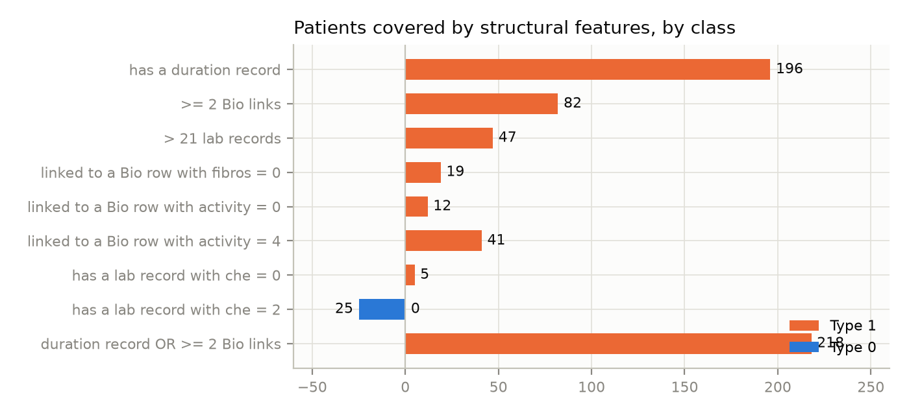
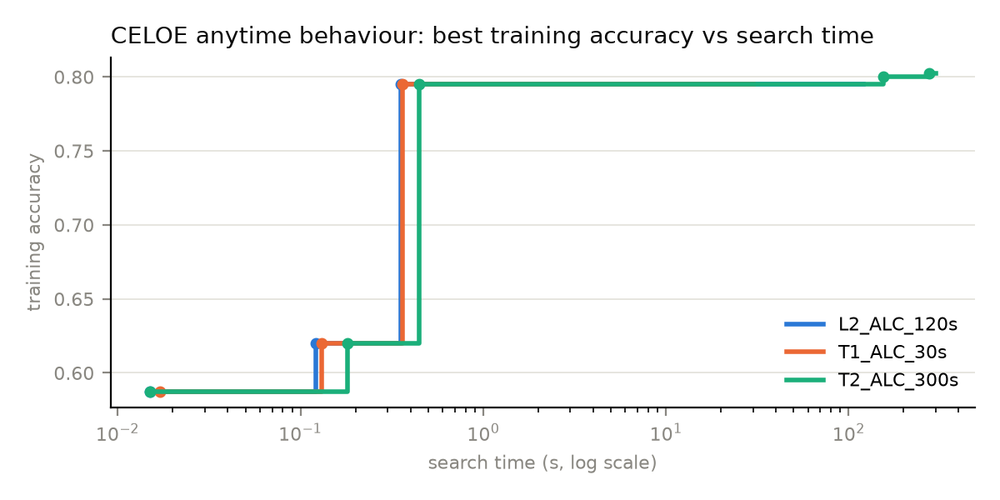
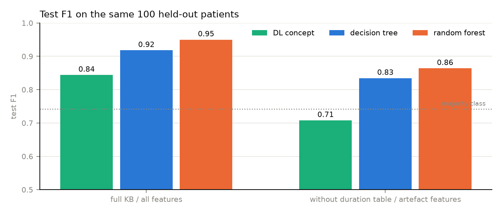

# Concept induction on the CTU Hepatitis relational database

DL-Learner class expressions for hepatitis type 1 vs trees and forests

<member 1>, <member 2> · Symbolic Learning · 12 minutes

---

## 1 · Dataset: Hepatitis_std (CTU Prague, PKDD'02)

- 7 tables, 12,927 rows, 500 patients, target `dispat.Type` (294 Type 1 / 206 Type 0)
- `Bio` profiles (many-to-many, shared rows), `indis` lab records (0–105 per patient), `inf` duration record (0–1)
- All attributes pre-discretised ordinal codes, no missing values, meaning of codes undocumented
- **Class-exclusive structure**: duration record (196, all Type 1), ≥2 Bio links (82, all Type 1)

---

## 2 · Knowledge base (Owlready2, `src/build_ontology.py`)

- Rows → individuals: 500 Patient, 32 BioProfile, 5,691 LabRecord, 196 DurationRecord
- Foreign keys → object properties `hasBioProfile`, `hasLabRecord`, `hasDurationRecord`
- Codes → value classes (`GOT_3 ⊑ LabRecord`, 69 classes) **and** integer data properties (`gotCode = 3`)
- `Type` never enters the ontology; labels and the 80/20 split live outside
- v2 adds 16 disjointness axioms; `noinf` variant drops the duration table (ablation)

---

## 3 · Learning problem and hypothesis languages

- P = 235 Type-1, N = 165 Type-0 **training** patients; 100 test patients unseen
- DL-Learner 1.5 (CELOE / OCEL), closed-world reasoner, start class `Patient`
- Languages: **EL** (⊓ ⊔ ∃) · **ALC** (+¬ ∀) · **ALCQ** (+≥n/≤n) · **ALC(D)** (+`code ≥ k`) · FULL
- Settings varied: runtime 30/120/300 s · depth 4/7/12 · heuristic penalty · **noise 0–90 %** · accuracy measure · OCEL
- 21 `.conf` files, 215 concepts, every training accuracy reproduced by our own evaluator

---

## 4 · What was learned (full KB)

| Run | Concept | Train acc | Test acc | Test P / R / F1 |
|---|---|---:|---:|---|
| ALC, 120 s | `∃hasDurationRecord.⊤` | 0.795 | 0.84 | 1.00 / 0.73 / 0.84 |
| EL, 120 s | `(Age_5 ⊓ Sex_1) ⊔ ∃hasDurationRecord.⊤` | 0.803 | 0.82 | 0.92 / 0.76 / 0.83 |
| ALCQ, noise 90, 300 s | `Age_6 ⊔ ∃hasDurationRecord.⊤` | 0.800 | 0.83 | 0.92 / 0.78 / 0.84 |
| ALC, noise 0 | `Patient ⊓ (Sex_0 ⊔ ¬Age_0)` | 0.593 | 0.59 | trivial |
| ALC, noise 25 | `∃hasLabRecord.(CHE_6 ⊓ ¬ZTT_1)` | 0.725 | 0.72 | 0.68 / 0.98 / 0.81 |

Every language converges on the same perfectly precise, **spurious** role concept.

---

## 5 · Effect of the settings

- **Noise** decides what is findable: CELOE prunes concepts covering < (1 − noise) of P. 0 % → tautologies; 25 % → lab concepts; ≥ 50 % → duration artefact
- **Language**: richer ⇒ larger branching factor (EL 193k vs FULL 59k descriptions / 120 s), not better concepts
- **Runtime**: artefact found in < 0.5 s; +300 s buys +0.8 % train and −1 % test (longer disjunctions overfit)
- **Depth, heuristic**: same best concept; low penalty → long redundant solutions `∃hasDurationRecord.(¬Duration_0 ⊔ ¬Duration_3)`

---

## 6 · Removing the artefact (KB without `inf`)

| Language | Concept | Train | Test acc | Test F1 |
|---|---|---:|---:|---:|
| ALC | `∃hasLabRecord.(ZTT_5 ⊓ ¬GPT_3)` | 0.738 | 0.67 | 0.68 |
| FULL | `Age_6 ⊔ (≥2 hasLabRecord.ZTT_5)` | 0.748 | 0.63 | 0.63 |
| ALC(D), 300 s | `∃hasLabRecord.(ZTT_5 ⊔ (ALB_0 ⊓ TTT_0))` | 0.750 | 0.67 | 0.71 |

- Lab-based concepts consistent with the class statistics (ZTT code 5: 91 % Type 1 at record level)
- Qualified cardinality is the only way a DL concept can "count" lab records

---

## 7 · Open world vs closed world (HermiT on the learned concepts)

| Concept | CWA | OWA v1 (no disjointness) | OWA v2 (disjoint) |
|---|---:|---:|---:|
| `∃hasDurationRecord.⊤` | 196 | 196 | 196 |
| `Patient ⊓ (Sex_0 ⊔ ¬Age_0)` | 498 | 355 | 498 |
| `∃hasLabRecord.(ZTT_5 ⊓ ¬GPT_3)` | 254 | 0 (timeout) | 254 |
| `Age_6 ⊔ (≥2 hasLabRecord.ZTT_5)` | 249 | 71 | 243 |
| `∀hasLabRecord.¬CHE_2` | 475 | not entailed | not entailed |

Negation and cardinality need disjointness; ∀ needs closure axioms. Learn closed-world, but add the axioms before reading ¬/∀ concepts as facts.

---

## 8 · Baseline on the same split (107 propositionalised features)

| Features | Tree (depth, leaves) | Tree F1 | Forest F1 |
|---|---|---:|---:|
| sex, age only | 4, 10 | 0.66 | 0.66 |
| all relational | 4, 8 | 0.92 | 0.95 |
| without artefacts | 3, 6 | 0.84 | 0.86 |

---

## 9 · Symbolic vs classical: what each gave

**Concept induction**
- One readable sentence over the schema, roles included, no feature engineering
- Explicit control of the hypothesis space; the artefact was *visible* in the concept
- Precision 1.0 concepts; short concepts generalise (train ≈ test)

**Trees / forests**
- Aggregation over one-to-many relations (means, modes, counts) → +8–15 points F1
- Insensitive to pruning/noise settings that decide what CELOE can find at all
- Forest is opaque; tree thresholds are on engineered features

---

## 10 · Conclusions

- Relational DB → OWL KB (6,419 individuals) → DL-Learner → evaluation under CWA and OWA → same-split baselines, fully reproducible (`run_all.sh`, 21 committed `.conf`)
- Best DL concept: test F1 0.84 (precision 1.0) but a data-collection artefact; without it 0.68–0.71 vs 0.84–0.86 for the baselines
- Lessons: noise % is a hard shape constraint in CELOE; disjointness/closure axioms are prerequisites for negative and universal concepts under OWA; length regularises
- Limits: undocumented code semantics, single split, ABox size at CELOE's practical limit

Questions?
